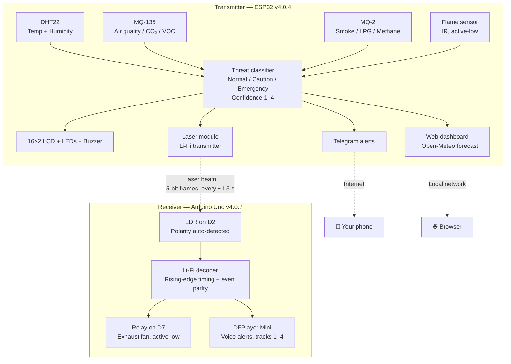
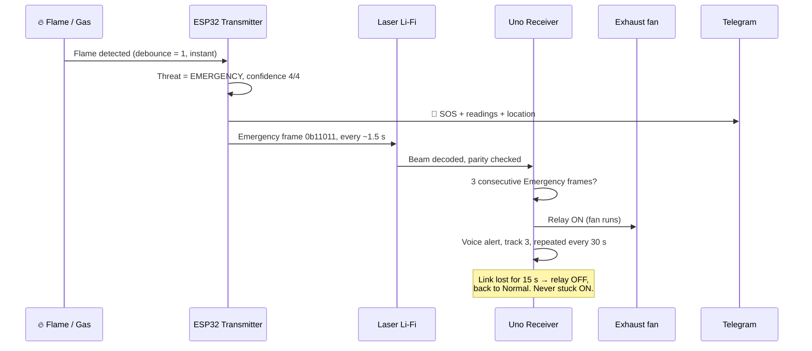
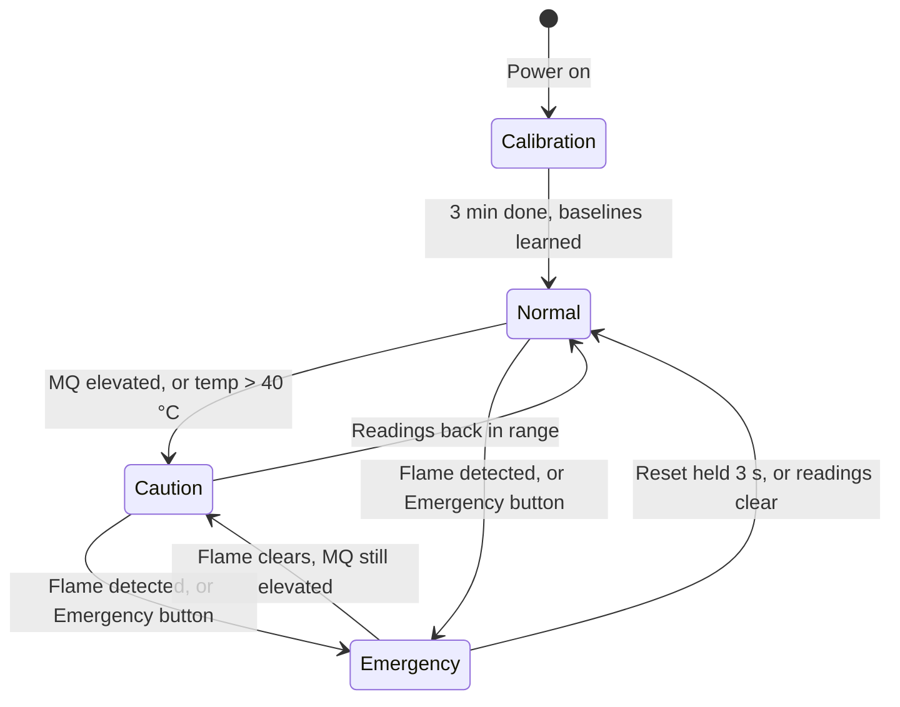
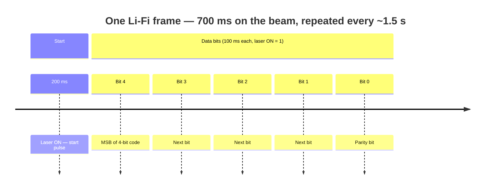
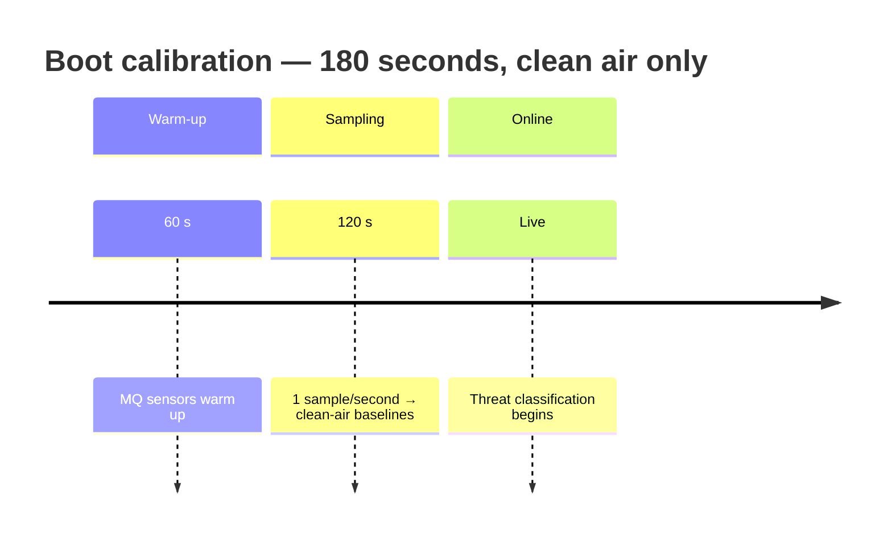

<div align="center">

# 🔥 ARIA

### Autonomous Risk Identification & Alert System

**A two-unit fire and hazardous-gas detection system that talks over laser light.**


-00599C?style=flat-square)


*ESP32 senses. A laser beam carries the verdict. Arduino Uno acts — even when the internet is down.*

</div>

---

> **⚠️ Read this first — honest status**
>
> - **This is a college mini-project prototype, not a certified safety device.** MQ gas sensors give *indicative* readings, not calibrated gas concentrations. ARIA does **not** replace certified smoke / gas alarms, and no claim in this repo should be read as one.
> - **This repo is a fork.** Upstream: [chakshu-byte/ARIA](https://github.com/chakshu-byte/ARIA). Changes here live on this fork only unless they are proposed upstream.
> - **This public copy is sanitized.** Every Wi-Fi, Telegram and location value in the transmitter is a placeholder. Fill in your own values locally before flashing, and never commit real credentials — if a token or password was ever shared or committed elsewhere, rotate it first (Telegram: BotFather → revoke; Wi-Fi: change the hotspot password).
> - **Licence: not yet chosen.** Neither this fork nor the upstream repo carries a licence file. Do not treat the code as licensed for reuse until the team picks one — see [CONTRIBUTING.md](CONTRIBUTING.md).

**Team — Vasavi College of Engineering, ECE mini-project**

| Member | Role in this repo |
|---|---|
| Parveda Aneesh | Transmitter (ESP32) — sensing, threat logic, Telegram, dashboard |
| Thammishetty Saimanish | Team member |
| Chakshu Varma Akkala | Upstream repo owner — receiver side |

**Versions in this repo:** transmitter **v4.0.4** (ESP32) · receiver **v4.0.7** (Arduino Uno)

---

## Contents

- [The idea in 30 seconds](#the-idea-in-30-seconds)
- [System architecture](#system-architecture)
- [How a threat flows through the system](#how-a-threat-flows-through-the-system)
- [Threat levels and confidence](#threat-levels-and-confidence)
- [The Li-Fi protocol](#the-li-fi-protocol)
- [Calibration — why the first 3 minutes matter](#calibration--why-the-first-3-minutes-matter)
- [Fail-safes](#fail-safes)
- [Hardware](#hardware)
- [Setup](#setup)
- [Web dashboard](#web-dashboard)
- [Repo layout](#repo-layout)
- [Docs](#docs)
- [Contributing and security](#contributing-and-security)

---

## The idea in 30 seconds

Most single-sensor alarms cry wolf or miss the real thing. ARIA instead fuses **four independent sensing channels** — temperature/humidity, air quality, smoke/LPG, and flame — into one confidence score, then pushes that verdict out through **three independent channels**: a laser beam to a local actuator, a Telegram message to your phone, and a local web dashboard. If Wi-Fi dies, the laser link and the receiver still work, because the receiver has no Wi-Fi of its own to lose.

```
  DHT22  MQ-135  MQ-2  Flame
     \      |      |      /
      └──── ESP32 (brain) ────┬──► Laser Li-Fi ──► Arduino Uno ──► Fan relay + voice alerts
                               ├──► Telegram (SOS / Caution / All Clear / heartbeat)
                               └──► Web dashboard (live data + 5-hour forecast)
```

---

## System architecture



---

## How a threat flows through the system



---

## Threat levels and confidence



| Level | Trigger | What happens | Confidence |
|---|---|---|---|
| 🟢 **Normal** | All sensors in range | Green LED, heartbeat every 5 min | 1/4 |
| 🟡 **Caution** | MQ elevated, or temp > 40 °C | Yellow LED, slow buzzer, Telegram Caution listing active sensors | = active sensor count |
| 🔴 **Emergency** | Flame detected, or manual Emergency button | Red LED strobe, fast buzzer, Telegram SOS, fan relay at receiver | 4/4 |

**Why flame is instant:** flame detection uses debounce = 1 by design — one flame reading triggers Emergency immediately. There is no averaging delay on the one sensor that means "fire, right now".

**Confidence is a count, not a probability.** A Caution with 3 active sensors scores 3/4. It says "three independent channels agree something is off" — it is not a calibrated probability of fire.

### Sensing, compensation and baselines

- **Compensation:** MQ readings are temperature/humidity compensated — `reading / (1 + 0.02·(T−20) + 0.01·(H−65))` — and smoothed with an 8-sample moving average, so a hot afternoon does not read as a gas leak.
- **Baselines adapt slowly in Normal state only.** They **freeze during Caution / Emergency**, so a real leak cannot be slowly "learned away" as the new normal.
- **Thresholds (from the code):** temp > 40 °C, MQ deviation > +50 ADC counts = elevated. These are prototype tuning values, not certified alarm thresholds.

---

## The Li-Fi protocol

A custom 5-bit protocol, designed so a single flipped bit cannot fake an Emergency.



| State | 4-bit code | 5-bit frame (with parity) |
|---|---|---|
| 💓 Heartbeat | `0b1000` | `0b10001` |
| ⚠️ Warning (Caution) | `0b1010` | `0b10100` |
| 🚨 Emergency | `0b1101` | `0b11011` |
| ✅ All Clear | `0b1001` | `0b10010` |

**Parity is even:** the receiver discards any frame whose 5-bit XOR is not 0.

**The v4.0.7 fix that matters:** the receiver times everything from the **rising edge** of the start pulse, not the falling edge. That falling edge does not exist when bit 4 = 1 — the laser simply stays on from the start pulse straight into bit 4, and the old falling-edge decoder sampled every bit 100 ms late. Sampling happens at each bit's midpoint (250 / 350 / 450 / 550 / 650 ms after the rising edge).

---

## Calibration — why the first 3 minutes matter



Calibrate **in clean air only**. A baseline learned in a smoky room is a blind system. After calibration there is a 45 s grace period before Caution can trigger, so the system settles instead of alarming on its own warm-up drift.

---

## Fail-safes

Safety systems fail in specific ways, so each one has a named countermeasure in the code:

| Failure | Countermeasure |
|---|---|
| Laser link broken / transmitter dead | Receiver: no valid frame for 15 s → relay OFF, back to Normal. A dead link can never leave the fan stuck on. |
| One corrupt Li-Fi frame | Even parity rejects it; relay needs **3 consecutive** Emergency frames before switching on. |
| A leak slowly raising the baseline | Baselines freeze in Caution / Emergency. |
| Telegram task crashing the ESP32 | v4.0.4 fix: the FreeRTOS queue carries `char*` (strdup/free), not `String` objects — the old version memcpy'd Strings through the queue and corrupted the heap. Telegram task stack raised to 10240 bytes. |
| Receiver stuck with relay on | 10 s safety watchdog: relay on while threat is Normal → forced off. |
| Receiver audio missing | DFPlayer init retried 3×; system still runs on relay + Serial if audio is offline. |
| Wi-Fi down | Transmitter keeps sensing, alarming locally and over Li-Fi; it retries Wi-Fi every 15 s. The receiver never needed Wi-Fi at all. |
| Laser pointed at eyes | **Human rule, not code:** never align the laser by looking into it. Align by watching the receiver's Serial output, not the beam. |

---

## Hardware

### Transmitter — ESP32

| Part | Notes |
|---|---|
| DHT22 | Temperature & humidity |
| MQ-135 | Air quality / CO₂ / VOC |
| MQ-2 | Smoke / LPG / methane |
| Flame sensor (IR, active-low) | Instant Emergency on detection |
| Laser module | Li-Fi transmitter |
| 16×2 LCD (I²C, 0x27) | Local status |
| LEDs, buzzer, buttons | Green / Yellow / Red, audible alarm, manual Emergency, 3 s hold Reset |

Transmitter pins (verified from `transmitter/ARIA_transmitter.ino`):

| Signal | Pin |
|---|---|
| DHT22 | 4 |
| Flame | 18 |
| MQ-135 DO / AO | 13 / 32 |
| MQ-2 DO / AO | 14 / 33 |
| LED green / yellow / red | 2 / 15 / 26 |
| Buzzer | 25 |
| Laser | 12 |
| Emergency button / Reset button | 16 / 17 |

### Receiver — Arduino Uno

| Part | Notes |
|---|---|
| LDR (D2) | Li-Fi receiver, polarity auto-detected on startup |
| Relay (D7, active-low) | Exhaust fan, needs 3 consecutive Emergency frames |
| DFPlayer Mini (RX 10 / TX 11) | MP3 alerts from microSD |
| Speaker | Voice announcements |

---

## Setup

1. **Transmitter:** open `transmitter/ARIA_transmitter.ino` in Arduino IDE, board: ESP32.
   **Receiver:** open `receiver/ARIA_receiver.ino`, board: Arduino Uno.
2. **Libraries** — transmitter: `LiquidCrystal_I2C`, `DHT`, `ArduinoJson`, plus ESP32 `WiFi`, `WiFiClientSecure`, `WebServer`, `HTTPClient`, `Preferences`, FreeRTOS. Receiver: `DFRobotDFPlayerMini`, `SoftwareSerial`.
3. **Credentials (local only):** replace the placeholder values in the transmitter with your own Wi-Fi, Telegram and location values — see `transmitter/secrets.h.example`. Never commit the filled-in values; `secrets.h` is already in `.gitignore`.
4. **Receiver microSD:** place MP3 tracks 1–4 as startup, warning, emergency, all-clear.
5. **Flash, power on in clean air**, let the 3-minute calibration finish, then align the laser onto the receiver LDR (watch Serial output, not the beam).

## Web dashboard

The transmitter serves a dashboard on the ESP32's IP (shown on Serial and LCD):

- `/` — live status, active sensors, event log, 5-hour Open-Meteo forecast (free, no key)
- `/data` — live readings as JSON, refreshed every 2 s by the page

---

## Repo layout

```
transmitter/ARIA_transmitter.ino   ESP32 transmitter v4.0.4 (sanitized)
transmitter/secrets.h.example      Placeholder credential template
receiver/ARIA_receiver.ino         Arduino Uno receiver v4.0.7
docs/ARIA_Project_Explained.html   Project documentation
docs/aria_v4_whitepaper.html       Engineering whitepaper
```

## Docs

- [`docs/ARIA_Project_Explained.html`](docs/ARIA_Project_Explained.html) — system, sensors, Li-Fi, threat logic
- [`docs/aria_v4_whitepaper.html`](docs/aria_v4_whitepaper.html) — deeper engineering analysis, fail-safes, compensation and timing

## Contributing and security

- Contributions: see [CONTRIBUTING.md](CONTRIBUTING.md) — including the fork rule (this is a fork of [chakshu-byte/ARIA](https://github.com/chakshu-byte/ARIA)) and the hardware-safety rules.
- Security issues: see [SECURITY.md](SECURITY.md). Never put a real Telegram token, Wi-Fi password or location in an issue, a PR, or a commit.
- Code of conduct: [CODE_OF_CONDUCT.md](CODE_OF_CONDUCT.md). Accessibility statement: [ACCESSIBILITY.md](ACCESSIBILITY.md).

---

<div align="center">

**Built by a Vasavi ECE team, for a room that should warn you before it hurts you.**

*Prototype, honestly labelled — not a certified alarm.*

</div>
